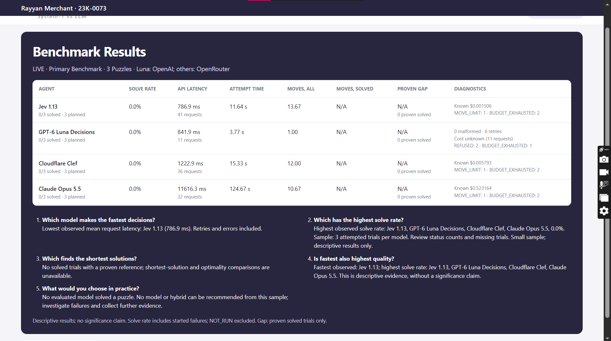

# CubeRace: System-1 vs LLM

**AI Engineering Assignment 02**

**Rayyan Merchant · 23K-0073**

[](https://drive.google.com/file/d/1vxPSwLyxMrOA4skjHODKMPuybu6Oh9ES/view?usp=sharing)
[](benchmark-data/)
[](#benchmark-results)
[](https://github.com/rayyan-merchant/CubeRace-System1-vs-LLM)

## Overview

CubeRace compares three System-1 decision models with a frontier LLM on Rubik’s Cube solving. Each model starts from the same scrambled state and independently selects legal moves within a **30-action limit**.

| Model | Assigned model ID | Interface |
|---|---|---|
| Jev 1.13 | `typesafe/jev-1.13` | Decisions |
| GPT-6 Luna Decisions | `openai/gpt-6-luna-decisions` | Decisions |
| Cloudflare Clef | `cloudflare/clef` | Decisions |
| Claude Opus 5.5 | `anthropic/claude-opus-5.5` | Chat completions with strict JSON |

The application includes a real-time four-model arena, cube visualizations, benchmark analysis, a fullscreen results slide, SQLite persistence, replay, and JSON/CSV exports. Student identity remains visible throughout the interface.

## Experimental Method

- **Actions:** all 18 standard face turns using the Half-Turn Metric; each action counts as one move.
- **Shared information:** current 54-facelet state, labeled face grids, solving objective, turn conventions, remaining allowance, and each agent’s last six moves.
- **Fair comparison:** equivalent decision information across models; identical question wording and criteria for the three OpenRouter Decisions requests.
- **No solution assistance:** live agents receive no scramble sequence, inverse solution, BFS hints, heuristic scores, or successor-state previews.
- **Puzzle tiers:** warm-up, 3–4 turns; primary, 4–5 turns; extension, 15–20 turns.
- **Reference solver:** BFS establishes shortest paths for supported shallow puzzles.
- **Metrics:** solve rate, mean API latency, total attempt time, executed moves, solved-path length, and optimality gap.
- **Provenance:** live and simulated results remain separate. Refusals, API errors, budget exhaustion, and incomplete trials remain recorded.

## Benchmark Results



The displayed results cover **three primary puzzles**. No model solved a puzzle. The run includes refusals and budget-exhausted trials, so it is descriptive evidence rather than a complete evaluation of solving ability. The assignment recommends at least five primary puzzles.

**Recorded provider condition:** Luna used direct OpenAI Decisions with native model `gpt-6-luna`; the other models used OpenRouter. Luna had up to three refusal retries. This differs from the assignment’s all-OpenRouter profile, and the current restored source does not include that retry extension.

| Assignment question | Observed answer |
|---|---|
| Which model makes decisions fastest? | Jev had the lowest mean request latency: **786.9 ms**. |
| Which has the highest solve rate? | All four tied at **0/3 solved (0%)**. |
| Which finds the shortest solutions? | Unavailable: no solved trials or solved-path optimality comparisons. |
| Is the fastest model also highest quality? | Lower latency did not produce a successful solution in this sample. |
| Which approach would you use in practice? | This sample supports no solving-performance recommendation; a hybrid was not evaluated. |

### Benchmark Data

The exports below correspond to run `1b3879eefd4c425dbd8feef00e2b2c21`, shown in the slide:

- [Complete run and recorded configuration](benchmark-data/run.json)
- [Trial summary](benchmark-data/summary.csv)
- [Executed moves and states](benchmark-data/steps.csv)
- [API requests, outcomes, latency, and reported billing](benchmark-data/requests.csv)

Missing provider costs remain unknown. Replay and export do not initiate inference.

## Setup

Requires **Python 3.10+**.

```powershell
git clone https://github.com/rayyan-merchant/CubeRace-System1-vs-LLM.git
cd CubeRace-System1-vs-LLM

python -m venv .venv
.venv\Scripts\python.exe -m pip install -r requirements.txt

# First-time setup only; preserve an existing .env.
Copy-Item .env.example .env

.venv\Scripts\python.exe -m uvicorn backend.main:app --host 127.0.0.1 --port 8000
```

Open **http://127.0.0.1:8000**.

Simulation is enabled by default. For live execution, configure `.env`:

```dotenv
OPENROUTER_API_KEY=your_key
LUNA_PROVIDER=openrouter
ALLOW_LIVE=true
OPENROUTER_MOCK_MODE=false
API_RETRIES=0
CLAUDE_REASONING_EFFORT=low
CLAUDE_MAX_TOKENS=2048
STUDENT_NAME=Rayyan Merchant
STUDENT_ROLL=23K-0073
```

For the alternative direct-OpenAI Luna route, set `LUNA_PROVIDER=openai` and supply `OPENAI_API_KEY`.

Keep credentials server-side and never commit `.env`. Live runs require explicit paid-call confirmation and respect persistent request limits.

## Run and Verify

Use **Race Arena** for a shared scramble and four-model race. Use **Benchmark Analysis** to run a suite, inspect metrics, replay saved runs, and export evidence. Finish the demonstration on **Results Slide**.

```powershell
.venv\Scripts\python.exe -m pip install -r requirements-dev.txt
.venv\Scripts\python.exe run_verification.py
.venv\Scripts\python.exe scripts/verify_browser.py
```

Automated verification uses offline fixtures and simulated runs; it does not establish live API availability or model-solving performance.
